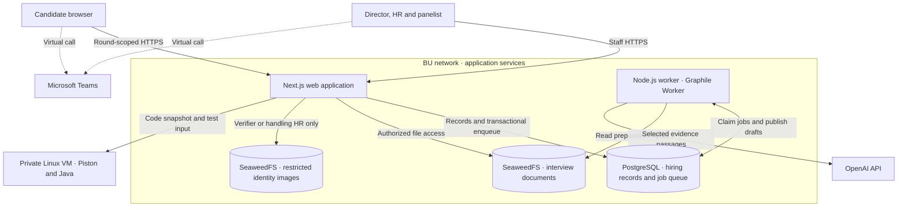

# BU Interview Studio — product architecture

**19 November 2026 · Architecture for the local, synthetic-data proof of concept**

The platform runs on the BU network as one TypeScript application with two processes: a web server for interactive work and a worker for preparation and AI jobs. PostgreSQL owns hiring decisions and their history. SeaweedFS owns uploaded files. Candidate Java code runs in a separate Linux VM. A panelist can finish and sign an interview using the saved guide, notes and code when hosted inference is unavailable. The business rules and pilot scope are defined in the [final product plan](./product-plan.md).

## 1. High-level architecture

The two SeaweedFS nodes represent private buckets on one local instance. HTTPS enters through a reverse proxy. Staff and candidate routes have separate access policies. Solid arrows identify callers and dependencies; the Java runner returns observed results to the application. The dotted paths carry meeting media directly through Teams. For an office interview, the panelist and candidate open the same application on separate devices.

## 2. Technology decisions

| Area | Selected stack | Use in this product |
| --- | --- | --- |
| Web and server | Next.js App Router, React, TypeScript, Node.js LTS | Self-host one app for the four role views and server endpoints. Share domain logic with the worker. Keep mutations and authorization on the server. [Next.js self-hosting](https://nextjs.org/docs/app/guides/self-hosting) |
| UI | Tailwind CSS v4 with the Turbopack loader from Create Next App, **shadcn/ui from the official registry**, Radix-based components | Commit the component source and configuration. Use shared theme tokens for spacing, color and focus. Compose the import preview from Table, Field and Dialog; use the same controls for scorecards and director review. Bundle assets locally. [Create Next App](https://nextjs.org/docs/app/api-reference/cli/create-next-app) · [shadcn/ui for Next.js](https://ui.shadcn.com/docs/installation/next) |
| Database | PostgreSQL, node-postgres (`pg`), Drizzle ORM and Drizzle Kit | Typed queries and reviewed migrations. Use SQL migrations for row policies and scheduling constraints. [Drizzle migrations](https://orm.drizzle.team/docs/migrations) |
| Jobs | Graphile Worker | Enqueue through SQL within the business transaction. A separate process consumes jobs and records progress in application tables. [Graphile Worker](https://worker.graphile.org/docs/sql-add-job) |
| Object storage | SeaweedFS with its S3 endpoint, AWS SDK for JavaScript v3 (`@aws-sdk/client-s3`) | Use a configured local endpoint, path-style addressing and server-held bucket-scoped credentials. Persist SeaweedFS metadata and object data across restarts. [SeaweedFS](https://github.com/seaweedfs/seaweedfs) · [S3 identities and permissions](https://github.com/seaweedfs/seaweedfs/wiki/S3-Credentials) |
| Intake | ExcelJS, Mozilla PDF.js (`pdfjs-dist`), Mammoth | Read and generate XLSX files. Extract PDF passages by page and DOCX plain text by paragraph. Retain the original object for review. [ExcelJS](https://github.com/exceljs/exceljs) · [PDF.js](https://mozilla.github.io/pdf.js/) · [Mammoth](https://github.com/mwilliamson/mammoth.js) |
| AI | Vercel AI SDK (`ai`, `@ai-sdk/openai`), Zod, hosted OpenAI models | Validate task-specific inputs and outputs. Choose the model using synthetic evidence-grounding, latency and cost evaluations, then pin the model identifier per deployed configuration. [OpenAI provider](https://ai-sdk.dev/providers/ai-sdk-providers/openai) · [Structured outputs](https://ai-sdk.dev/docs/ai-sdk-core/generating-structured-data) |
| Coding | CodeMirror 6, `@codemirror/lang-java`, self-hosted Piston, pinned Java runtime | Candidate edits, panelist observes saved revisions, and a separate VM compiles and runs the exercise. [CodeMirror](https://codemirror.net/) · [Piston deployment requirements](https://github.com/engineer-man/piston) |
| Meetings | Microsoft Teams | HR creates the meeting and supplies its join link. The exercise invitation opens the candidate workspace separately. [Guest joining](https://support.microsoft.com/en-us/teams/meetings/join-a-meeting-without-an-account-in-microsoft-teams) |
| Delivery and quality | pnpm, pinned Biome with committed biome.json, Vitest, Playwright, Compose | One repository and lockfile. Build the web and worker from the same image. Test business rules with Vitest, database invariants against PostgreSQL, and role journeys with Playwright. |

Use maintained open-source components for local services and libraries. Pin compatible package versions and image digests during implementation. ExcelJS and Piston are the selected implementations; validate workbook fidelity in the intake workflow and runtime behavior through the interview workspace’s Run action.

## 3. Domain modules and durable records

| Module | Records it owns | Invariant |
| --- | --- | --- |
| BU access | Staff, BU, membership, director ownership history, setup grant | Exactly one director per active BU and one active BU per director. Transfer ownership in one transaction. A delegate drafts configuration; the director publishes it. HR and panelists can belong to multiple BUs. |
| Standards and demand | Capability pack, rubric, question, exercise, opening revision, optional batch | A batch shares an opening version. An ad hoc interview uses the same application lifecycle. New versions require explicit adoption for pending interviews. Completed rounds retain their versions. |
| Intake | Candidate, skill experience, application, import row, resume version, passage | Unique normalized email per BU and one application per candidate and opening. Record both total IT and primary-skill experience as months. Snapshot confirmed relevant months on the application. |
| Scheduling | Panel qualifications, availability, active bookings, round assignments, access grants | Recheck BU, skill, round, conflicts and availability on confirmation. Panelist relevant months must meet or exceed candidate relevant months for the same hiring skill. Unknown durations require HR confirmation. |
| Assessment | Actual questions, hints, notes, code revisions, runs, evidence references, scorecards, decisions, overrides | Signed assessments retain attribution, source evidence and rubric version. Client readiness and reusable BU capability have separate fields. |
| Operations | Preparation status, AI draft, exception, follow-up action, audit event | An exception has an owner and next action. Dashboards use persisted workflow states. Signed decisions, overrides and source corrections are traceable. |

Put BU identifiers on scoped records and use composite foreign keys to prevent cross-BU references. Server operations check actor, membership, assignment and resource. Use PostgreSQL row-level security with non-owner runtime roles, transaction-local BU context and equivalent scoping for worker jobs. For availability, expose a busy/free check across BUs. Enforce an exclusion constraint on the global panelist ID and overlapping active time ranges using GiST and btree_gist. Adjacent slots can meet at a boundary. Return a generic conflict to HR and retain the other BU’s appointment details privately. [PostgreSQL row security](https://www.postgresql.org/docs/current/ddl-rowsecurity.html) · [Range constraints](https://www.postgresql.org/docs/current/rangetypes.html)

## 4. Storage and access

**PostgreSQL holds structured evidence.** Store questions actually asked, notes, code snapshots, run results, source locators, signed feedback and decision history in relational records. An attachment record includes BU, owning resource, classification, immutable object key, checksum, media type, size and lifecycle state. Use generated keys without candidate names or email addresses.

**SeaweedFS holds original bytes.** Run one authenticated local instance with persistent volumes. Provision an interview-documents bucket for workbooks, resumes and question packs, and a restricted identity-images bucket for virtual ID checks. Use separate service credentials. Give the preparation worker read access only to the documents it processes and no identity-bucket permissions. Only the web application’s identity-check handler uses the restricted runtime credential. All browser downloads pass through an authorization check. Restrict S3, filer and administrative interfaces to the private deployment network. [SeaweedFS bucket-scoped credentials](https://github.com/seaweedfs/seaweedfs/wiki/S3-Credentials)

**Recover partial uploads.** Reserve an attachment and unique key in PostgreSQL, stream the object with size limits, verify the checksum and mark it ready. Enqueue dependent work in the transaction that marks it ready. A retry resumes the same reservation or verifies the existing object. Clean up expired staged rows and orphaned objects. A delete request revokes reads immediately and queues idempotent byte removal with completion tracking. Back up PostgreSQL and SeaweedFS metadata and objects at a consistent recovery point. Restore a signed assessment and verify the checksums of its referenced files.

**Virtual ID checks.** The invitation explains the camera check and screenshot. The panelist compares the name and photo, then manually uploads the screenshot to the restricted record. Only the verifier and handling HR coordinator can open it. Other authorized reviewers, including the director, see the result. A mismatch creates an HR action. Keep identity images outside model inputs, feedback, routine logs and ordinary exports. Use fictional props for all POC rehearsals.

## 5. Intake, preparation and AI

1. HR chooses BU and opening, optionally a batch. Manual entry and workbook import use the same validation. Preview vendor column mappings and rows, preserve phone numbers as text, distinguish unknown experience from zero, and match uploaded resumes by unique filename. Apply upload, row, expanded-size and parsing-time limits.
2. Normalize email within the BU. HR can skip a duplicate, reuse the candidate or accept selected changes. Blank cells preserve prior values. Commit accepted rows and durable preparation jobs together, retain the import row and return concurrent conflicts for review. Repeating the import preserves existing applications and batch memberships.
3. Immediately assemble the core guide from the published Java pack and create the HR checklist. Extract resume text in parallel. An unreadable scan or ambiguous resume match leaves the guide usable and assigns HR a correction. Store stable page or paragraph references with the resume version.
4. The worker selects approved questions by BU, level, competency and pack version. Supply the model only the passages and evidence IDs required for the task. Generate clarification prompts for gaps or overlapping dates, suggested probes from panelist notes and editable feedback from observations. Validate output against Zod schemas and check reference ownership and quoted text before display. A panelist judges whether the evidence supports a conclusion.
5. Key each result by application, task and input versions. Record model, prompt version, status and usage. Use bounded retries and check versions again when saving. A late result cannot overwrite a human edit or signed decision. A crash after a provider response may incur a second call; a unique result key prevents duplicate visible drafts. Resume current jobs after connectivity returns, expire stale live probes and make exhausted retries visible to the owner.

AI receives evidence as data and has no authority to book appointments, merge identities, alter published rubrics or sign decisions. User-visible preparation status stays in application tables after queue entries complete. The director sees exceptions and evidence links; HR sees actionable intake and scheduling issues; the assigned panelist receives the guide. [Graphile Worker job keys](https://worker.graphile.org/docs/job-key)

## 6. Interview session and execution boundary

HR confirms time, timezone, assigned panelist and mode. For virtual rounds, HR arranges guest admission and communicates the camera expectation and alternatives. For office coding rounds, HR reserves a tested company laptop. Rescheduling preserves assessment work and replaces the booking and candidate grant. Withdrawal, cancellation and no-show are operational outcomes.

A short-lived candidate invitation exchanges a random secret for a scoped, secure session cookie. Store the secret’s hash and remove the secret from the browser address after exchange. Tie the session to the active round and check revocation on each request. End or reschedule the round to invalidate the grant and any open session. Staff demo identities and role switching are confined to the internal staff surface.

The candidate is the sole editor. Autosave uses a revision number to detect stale writes. The panelist’s read-only view polls for acknowledged revisions. Run saves an immutable snapshot with the exercise and Java runtime versions. The server sends source and test input to the private runner, compares output against trusted expectations, and persists compile errors, test observations or infrastructure failure distinctly. Keep hidden expected results on the application side. Submit identifies the exact revision used in feedback. A previous run remains linked to the code it actually executed.

Piston’s documented self-hosting setup uses Linux cgroups and includes a privileged container configuration. Give it a dedicated disposable Linux VM, private backend-only ingress, preinstalled Java runtime and bounded compile/run time, memory, output and process counts. Candidate programs have no outbound network access, hiring-data mounts or application credentials. Verify those boundaries on the target host. A runner outage preserves the submitted code and records execution as unverified. [Piston](https://github.com/engineer-man/piston)

## 7. Scoring, handoff and director override

L1 assesses DSA, implementation and core Java. L2 independently assesses service design, troubleshooting and ownership. The hiring pack supplies four anchored levels plus unassessed. A panelist records the question asked, observed answer or code, hints and rationale. A suggested question becomes evidence only after the panelist records what happened. Client-specific exposure, such as Azure, can require follow-up while the Java BU outcome remains valid.

L1 signs advance, hold or close. Advance opens L2, hold creates an owned follow-up, and close ends that application. L2 receives the L1 evidence with the overall verdict collapsed initially. L2 signs meets standard, falls below standard or needs further evidence. The outcome takes effect immediately. A director review leaves it effective. A director override requires a justification, preserves both signed assessments, appends the previous and revised disposition with actor and time, and creates an HR action if client submission is affected. Commit those writes together. Guard signing and overrides against concurrent edits using the expected decision revision.

A director can trace a summary to a signed score, question, notes and specific code run. Later source corrections create dated amendments and identify affected assessments. A later opening may reference a prior signed BU assessment after a panelist confirms its level, version and relevance. The new application owns any remaining client-specific questions.

## 8. Deployment, offline behavior and operations

Use Compose on the BU host for HTTPS ingress, web, worker, PostgreSQL and SeaweedFS. Keep the runner VM separate. Bundle UI assets, question packs and runtime dependencies locally. Persist database and object volumes across application updates. Expose only the candidate route through an approved HTTPS endpoint for external guest rehearsals. Staff sessions use seeded identities with synthetic records during development. Before a real pilot, use company OIDC for staff identity and keep BU roles and assignments in the application.

| Failure or change | Expected behavior |
| --- | --- |
| Internet unavailable, local network reachable | Import, local extraction, booking, cached guides, notes, Java execution and signing continue. Hosted AI work waits for connectivity. Teams availability depends on the meeting service. |
| Browser loses local connection | Display the last acknowledged revision and keep unsent editor text in the open tab for retry. Resolve a revision conflict on reconnect. |
| Worker restarts during preparation | Durable jobs resume. Current input versions and unique results protect newer work and signed decisions. |
| Object store or runner unavailable | Mark the affected upload or run as incomplete, preserve acknowledged records, and offer a retry. Never present an infrastructure error as a candidate failure. |

Use structured logs with request, application, job and run identifiers. Exclude raw resumes, ID images, code, prompts, invitation tokens and credentials. Measure queue age, extraction exceptions, stale drafts, AI usage and cost, Java latency and unfinished sessions. Compare HR handling time, preparation time and feedback editing time with a manual BU baseline. Use evidence coverage and unsupported assertions to evaluate draft quality.

## 9. Implementation and acceptance

| Sequence | What to demonstrate | Acceptance evidence |
| --- | --- | --- |
| 1. Workspace and BU foundation | Two BUs, distinct directors, shared staff, private uploads | Transfer a director atomically. Verify cross-BU denials, worker denial on identity images, interrupted-upload recovery and a database-plus-object restore. |
| 2. Intake and scheduling | Batch import plus ad hoc application | Round-trip the workbook and exception export in the implemented importer. Repeat an import without duplicate work. Missing or insufficient relevant months block booking. Two concurrent cross-BU requests for the same panelist slot yield one confirmation. |
| 3. Interview and recovery | Guest Teams session, candidate workspace and office laptop | Run the starter Java exercise offline through the workspace and verify executor limits and isolation. Revoke a live candidate session on reschedule. Trace a submitted revision to its run. Disconnect AI, restart the worker and finish with local evidence. |
| 4. Decisions and reuse | L1, L2, client submission and justified director override | Retrieve both original scores and their evidence. Reject an empty justification and stale revision. Show HR the effective decision and resulting action. Reuse the signed Java assessment for another opening in the BU. |

Development fixtures, resumes, answers, scorecards and identity images are synthetic. Pilot readiness requires actual guest and device tests plus company approval for real applicant access, retention, deletion and hosted inference. These rehearsals verify the architecture on its intended deployment.
